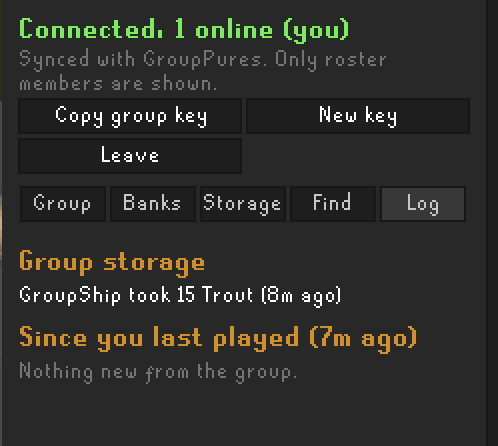
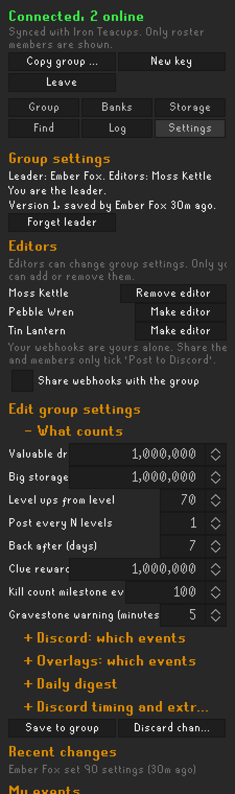
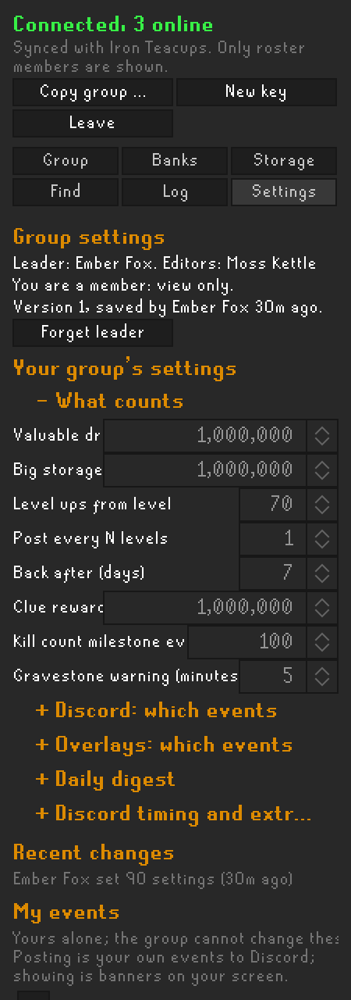
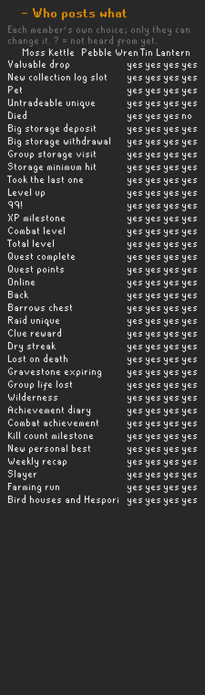

# GIM Utilities

Share banks, group storage changes, stats, drops, shopping lists, gear checks
and live bossing runs with your Group Ironman team over RuneLite Party.

Split out of Build Guard (which keeps its build and XP warnings) so the two
plugins can run side by side.

## Quick start

1. Install **GIM Utilities** from the Plugin Hub. Its sidebar button (green
   badge) is always available while the plugin is enabled.
2. One member opens the GIM Utilities panel, clicks **Create group key**, then
   **Copy group key**, and sends the key to the group outside the game (for
   example in Discord).
3. Everyone else copies the key and clicks **Paste group key** in the panel (or
   pastes it into *Group key* in the settings). On the **Share with your
   group?** card, click **Turn on sharing** to enable *Sync with my group* and
   every *Share* switch in one click (**Post my events to Discord** also shows
   when a webhook is set). Nothing turns on without your click.
4. Once per session, click **Join group sync** in the panel header (RuneLite
   Plugin Hub rules do not allow automatic party joins on login). The built-in
   Party plugin is not needed.

Anyone with your group key can join that party, so share it only inside your
group. Only players on your in-game Group Ironman roster are shown; anyone else
is ignored.

**Every setting, running from source, the Windows test launcher, and what to
test: [SETUP.md](SETUP.md).**

## Features

Sharing and Discord posting are off by default. Each member turns on what they
want to share, and only sees other members' data for categories they share
themselves.

The panel header shows your sync status, key controls, and a foldable **Quick
settings** card mirroring the ten most-used toggles (*Sync with my group*,
*Post to Discord*, *Keep my events off Discord*, *Share bank*, *Share storage
changes*, *Share stats*, *Group box*, *Members on world map*, *::find chat
command*, *Path stop card*) plus **All settings**. Below it sit ten tabs:

- **Group:** a collapsible card per member (yours fills from your own client
  even when sync is off) with world and location, HP / Prayer / Run / Spec orbs
  (with a gold ring while Prayer is active), poison / venom / disease chips,
  active follower pet, skills with boosts, quest points / diaries / boss bests,
  3x5 worn equipment (with slot silhouettes) and 28-slot inventory (with
  jewellery charges, log basket / fish barrel / coal bag item counts, and log
  basket / looting bag tooltips), rune pouch, quiver and seed vault. Offline
  members keep what they had the last time you were both synced. Roster members
  without the plugin still get a card (online status and world from the in-game
  Group channel, levels from the public OSRS hiscores), and online members not
  in sync show *not syncing, last synced ... ago*.

  

- **Banks:** each member's last closed bank with total Grand Exchange value,
  High Alchemy tooltips, search, nine category filter pills (*All*,
  *Resources*, *Food*, *Potions*, *Combat*, *Melee*, *Ranged*, *Magic*,
  *Runes*), collapsible cards (*Collapse all* / *Expand all*), a top-20 value
  preview (*Show all items* for the rest), and when it was seen.

- **Storage:** the last saved group storage contents and total value, plus a
  collapsible **Changes** log of the last 200 saved visits (committed only when
  the game saves). The search bar and nine category filter pills narrow both
  the item grid and the change log.

- **Find:** who holds an item and where (banks, inventories, worn equipment,
  rune pouches, quivers, seed vaults, known log basket / fish barrel / coal bag
  contents, and group storage), plus the newest three matching storage visits.
  Use the search box (with item shorthands), one-click presets (*Runes
  anywhere*, *Food*, *Teleports*), category / sub-type / holder dropdowns, or
  `::find <item>` in your own chatbox (*::find chat command*, with customisable
  colours).

- **Log:** up to 2,000 group events from the last 30 days kept across restarts:
  *Since you last played* on top, then one section per day. Search by member,
  item, place or text; filter by category (*Drops*, *Deaths*, *Storage*,
  *Progress*, *Group*, *Activities*), member and time (*Today*, *Last 7 days*,
  *All time*); hover for exact values and right-click to copy. Events recorded
  while you were not synced are backfilled automatically (without firing
  banners or Discord posts) the next time you join group sync.

  

- **Activities:** *All* / *Bossing* / *Minigames* filter over **Live now** runs
  in the **Fight Caves**, **The Inferno** and **Fortis Colosseum** (wave, total
  and wave timers, solo or team summary, Fight Caves spawn rotation 1-15,
  Colosseum glory and modifier tiers, and collapsible per-wave **Wave splits**
  with per-wave personal bests), **Personal bests** across bosses with the
  group best marked, and **Recent runs**.

- **Compare:** five views in consistent per-member colours: **Leaderboard**
  (Hiscores-style skill tile grid plus *Bossing*, *Activities* and *Minigames*
  counts), **Compare** (two members side by side), **Group** (your group's XP
  against up to five typed players on the public hiscores), **Item** (*Who
  benefits most?* ranked by stat gain over worn gear, ownership, and bundled
  OSRS Wiki equip level requirements), and **Banked XP** (skill XP and minimum
  levels from banked and carried supplies, with an option to count shared
  storage once).

- **Shopping:** folded shared shopping lists and personal item requests
  (*Request: ask the group*, claimable with **I'll get it**). Includes nine **1
  Defence pure** quest-milestone presets (subtracting quests and prerequisites
  each member has already completed, using bundled Quest Route and OSRS Wiki
  drop data) and custom lists. Items in banks, group storage, inventories or
  equipment count as *have*; **Path to** and **Path to next** route to the
  nearest reachable shop via the **Shortest Path** plugin (naming the town and
  next stop, with an optional on-screen *Path stop card* and chat *Shopping:
  shop alert*).

- **Gear:** **Bring this** checks for Revenant Caves, Vorkath, Zulrah, Barrows,
  Chambers of Xeric, Theatre of Blood, Tombs of Amascut, and Slayer tasks,
  selected automatically when you enter the region or picked from the list.
  Marks each requirement *OK*, *Equip* (in your inventory when it must be worn)
  or *Missing*, showing which teammates hold a missing item with one-click
  **Request from group** or **Add to shopping**. Lines carry counts (4 prayer
  potions), *any one of* a kind (any ranged weapon, anything but magic for
  Ahrim) read from the item's stats, optional lines, and *Skip* toggles for a
  sub-fight. **Make shopping list** turns every gap into one request for what
  teammates hold and one shopping list for the rest, each item once; pressing it
  again skips items already on your requests or lists. The pencil edits any list
  (items, counts, worn, optional, **Reset to default**), and you can add lists
  for places of your own, picked by region if you like. When an update changes
  a default list you edited, the tab offers **Reset to default** or **Keep
  mine**. Your edits are saved in your RuneLite settings profile (one set for
  all your accounts) and are not shared with the group.

- **Settings** (panel tab): ECDSA-signed group leader and editor roles, one
  group-wide set of thresholds and event switches (saved by the leader or an
  editor, read-only for other members, with version history), optional
  leader-shared Discord webhooks, per-member Discord and banner opt-outs, and a
  read-only **Who posts what** table.

  

As the leader

  

  

  

As a member

  

  

  

Who posts what

  

  

- **Group events, Discord and in-game overlays:** 41 event switches covering
  valuable drops, pets, collection log slots, untradeable uniques, raid
  uniques, clue rewards, dry streaks, deaths, death value lost, gravestone
  warnings, Hardcore group lives lost, Wilderness / skull alerts, big storage
  deposits and withdrawals, storage visit summaries, storage minimums, "took
  the last one", level-ups, 99s and max total, XP / combat / total / quest
  point milestones, quests, diary tiers, combat achievements, kill count
  milestones, personal bests, Slayer tasks, farming runs, bird houses and
  Hespori, Fight Caves / Inferno / Colosseum start / wave milestones /
  completions / deaths, shopping requests, `::announce` notes, online /
  offline, everyone online, "back after a break", weekly recaps and Barrows
  chests—plus desktop notifications for *Storage minimums* and *Show members on
  world map*. Each event can go to:
  - **Discord**, via up to seven webhooks (rich embeds or plain text,
    per-member *Combine level-ups* and *Group posts (minutes)* in-place
    editing, a daily-reposted *Live board*, optional screenshots including *Add
    picked-up screenshot* on drops and *Grave picture* on gravestones,
    big-event role mentions, quiet hours, Easter eggs, daily digests, and
    single-poster relay of in-game Group broadcasts for *Members without the
    plugin* in chronological order).
  - **In-game**, via deduplicated *Banner:* toasts (*Top centre*, *Top left*,
    *Top right*, *Above chatbox* or *Above player*, dismissable by hotkey or
    right-click, with *Banner quiet from / until*) and an optional **Group
    box** showing online members, active pets, stacked level-ups, recent
    events, five size presets, optional icons/timestamps, and configurable
    *Empty group box shows* lines when nobody else is online.

- **RuneLite configuration:** eight sections—*Group* (open by default) and
  *Discord: connection*, *Discord: what to post*, *Discord: how to post*,
  *Discord: daily digest*, *In-game*, *Thresholds* and *Advanced* (closed by
  default). Full setting reference: [SETUP.md](SETUP.md#settings).

## Privacy and network

GIM Utilities runs no server of its own. Group sync travels only through
RuneLite's built-in `PartyService`, restricted to names on your in-game Group
Ironman roster, and hiscore lookups read only from Jagex's official hiscores
through RuneLite's `HiscoreClient`. **Only the optional Discord webhook** is a
network call of the plugin's own: it stays off until you enable *Post to
Discord* and enter a webhook URL (or use webhooks shared by your group leader),
and it sends your IP address and your own events (plus single-poster in-game
Group channel broadcasts when enabled) to Discord.

## Discord webhooks

*Discord: connection* has seven webhooks. Only **Main webhook** is needed:
leave any category webhook empty and its posts route to Main while keeping that
category's own poster name (*Webhook's own*, *Default name*, or *Custom*).

| Webhook | What it posts | Default name |
| --- | --- | --- |
| Main | Clue rewards, dry streaks, Wilderness and skull, achievement diary tiers, combat achievements, kill count milestones, personal bests, Slayer tasks, farming runs, bird houses and Hespori, "back after a break", weekly recaps, shopping requests, `::announce` notes, everyone online, and any category whose webhook URL is left empty. | Town Crier |
| Online status | The *Live board*, or login and logout posts (*Online status*). Changing this URL starts a new board. | World Hopper |
| Drops & loot | Valuable drops, pets, new collection log slots, untradeable uniques, raid uniques, Barrows chests, "took the last one". | Party Pete |
| Progress | Level-ups, 99s and max total, XP milestones, combat level, total level milestones, quests, quest point milestones, and activity start, wave milestone and completion posts. | Skillcape Seller |
| Deaths & danger | Deaths, value lost on death, gravestone expiring warnings, Hardcore life lost, and activity deaths. | Death's Office |
| Group storage | Big storage deposits and withdrawals, storage visit summaries, storage minimums hit. | Gielinor Banker |
| Daily digest | Once-a-day summaries ticked under *Discord: daily digest*. | Varrock Herald |

Each webhook URL has its own queue and rate limit, so a busy Drops channel
never delays a death post.

## License

BSD-2-Clause. Bundled region names and farming/bird house cycles are adapted
from [RuneLite](https://github.com/runelite/runelite) (BSD-2-Clause), bank
tiles from [Shortest Path](https://github.com/Skretzo/shortest-path)
(BSD-2-Clause), quest item data from
[Quest Route](https://github.com/VinnyVanGogh/questpath-plugin) (BSD-2-Clause),
and item drop, equip-requirement and banked-XP tables from the
[Old School RuneScape Wiki](https://oldschool.runescape.wiki) (CC BY-NC-SA
3.0); group features are an independent implementation over RuneLite Party with
no code from Group Ironmen Tracker or Dink. See [LICENSE](LICENSE) and
[THIRD_PARTY_NOTICES.md](THIRD_PARTY_NOTICES.md).
