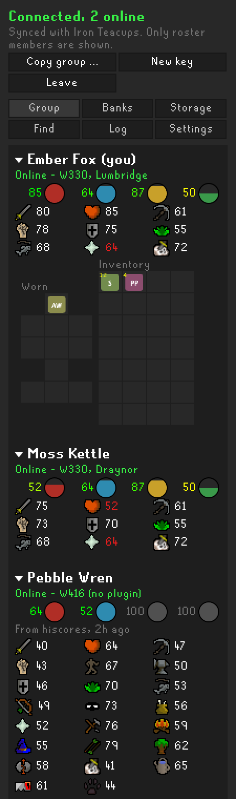

# GIM Utilities

Share banks, group storage changes, stats, drops, gear checks and live bossing
runs with your Group Ironman team over RuneLite Party.

Split out of Build Guard (which keeps its build and XP warnings) so the two
plugins can run side by side.

Three companion plugins from the Plugin Hub add more, and GIM Utilities hands
them your group's data so they feel built in:

- **Discord Relay** posts your group's events to Discord.
- **Player Compare** draws the **Compare** tab (leaderboard, banked XP, gear).
- **Group Shopping** draws the **Shopping** tab (shared lists, requests,
  *Path to*).

Without a companion, its tab or setting shows one line telling you which plugin
to install. Everything else works on its own.

## Quick start

1. Install **GIM Utilities** from the Plugin Hub. Its sidebar button (green
   badge) is always available while the plugin is enabled.
2. One member opens the GIM Utilities panel, clicks **Create group key**, then
   **Copy group key**, and sends the key to the group outside the game (for
   example in Discord).
3. Everyone else copies the key and clicks **Paste group key** in the panel (or
   pastes it into *Group key* in the settings). On the **Share with your
   group?** card, click **Turn on sharing** to enable *Sync with my group* and
   every *Share* switch in one click. Nothing turns on without your click.
4. Once per session, click **Join group sync** in the panel header (RuneLite
   Plugin Hub rules do not allow automatic party joins on login). Until you do,
   a *Group sync is off - click to join* banner and one chat reminder per login
   show; right-click the banner and pick **Join group sync** to join from
   there. The built-in Party plugin is not needed.
5. Optional: install **Discord Relay**, **Player Compare** and **Group
   Shopping** from the Plugin Hub for Discord posts, Compare and Shopping.

Anyone with your group key can join that party, so share it only inside your
group. Only players on your in-game Group Ironman roster are shown; anyone else
is ignored.

**Every setting, running from source, the Windows test launcher, and what to
test: [SETUP.md](SETUP.md).**

## Features

Sharing and Discord posting are off by default. Each member turns on what they
want to share, and only sees other members' data for categories they share
themselves.

The panel header shows your sync status, key controls, and a foldable **Quick
settings** card mirroring the most-used toggles (*Sync with my group*, *Keep
my events off Discord*, *Share bank*, *Share storage changes*, *Share stats*,
*Group box*, *Members on world map*, *::find chat command*) plus **All
settings**. Below it sit ten tabs:

- **Group:** a collapsible card per member (yours fills from your own client
  even when sync is off) with world and location, HP / Prayer / Run / Spec orbs
  (with a gold ring while Prayer is active), poison / venom / disease chips,
  active follower pet, skills with boosts, quest points / diaries / boss bests,
  3x5 worn equipment (with slot silhouettes) and 28-slot inventory (with
  jewellery charges, log basket / fish barrel / coal bag item counts, and log
  basket / looting bag tooltips), rune pouch, quiver and seed vault. Offline
  members keep what they had the last time you were both synced. Roster members
  without the plugin still get a card (online status and world from the in-game
  Group channel, levels from the public OSRS hiscores), and online members not
  in sync show *not syncing, last synced ... ago*.

  

- **Banks:** each member's last closed bank with total Grand Exchange value,
  High Alchemy tooltips, search, nine category filter pills (*All*,
  *Resources*, *Food*, *Potions*, *Combat*, *Melee*, *Ranged*, *Magic*,
  *Runes*), collapsible cards (*Collapse all* / *Expand all*), a top-20 value
  preview (*Show all items* for the rest), and when it was seen.

- **Storage:** the last saved group storage contents and total value, plus a
  collapsible **Changes** log of the last 200 saved visits (committed only when
  the game saves). The search bar and nine category filter pills narrow both
  the item grid and the change log.

- **Find:** who holds an item and where (banks, inventories, worn equipment,
  rune pouches, quivers, seed vaults, known log basket / fish barrel / coal bag
  contents, and group storage), plus the newest three matching storage visits.
  Use the search box (with item shorthands), one-click presets (*Runes
  anywhere*, *Food*, *Teleports*), category / sub-type / holder dropdowns, or
  `::find <item>` in your own chatbox (*::find chat command*, with customisable
  colours).

- **Log:** up to 2,000 group events from the last 30 days kept across restarts:
  *Since you last played* on top, then one section per day. Search by member,
  item, place or text; filter by category (*Drops*, *Deaths*, *Storage*,
  *Progress*, *Group*, *Activities*), member and time (*Today*, *Last 7 days*,
  *All time*); hover for exact values and right-click to copy. Events recorded
  while you were not synced are backfilled automatically (without firing
  banners or Discord posts) the next time you join group sync.

  

- **Activities:** *All* / *Bossing* / *Minigames* filter over **Live now** runs
  in the **Fight Caves**, **The Inferno** and **Fortis Colosseum** (wave, total
  and wave timers, solo or team summary, Fight Caves spawn rotation 1-15,
  Colosseum glory and modifier tiers, and collapsible per-wave **Wave splits**
  with per-wave personal bests), **Personal bests** across bosses with the
  group best marked, and **Recent runs**.

- **Compare** (needs **Player Compare**): **Open group compare** shows your
  group in Player Compare's panel, using the stats your group shares here:
  leaderboard, two members side by side, your group against typed players,
  *Who benefits most?* for an item, and banked XP.

- **Shopping** (needs **Group Shopping**): **Open shopping lists** shows your
  group's shared lists, item requests, quest presets and *Path to* in Group
  Shopping's panel, using the banks, storage and inventories your group shares
  here.

- **Gear:** **Bring this** checks for Revenant Caves, Vorkath, Zulrah, Barrows,
  Chambers of Xeric, Theatre of Blood, Tombs of Amascut, and Slayer tasks,
  selected automatically when you enter the region or picked from the list.
  Marks each requirement *OK*, *Equip* (in your inventory when it must be worn)
  or *Missing*, showing which teammates hold a missing item with one-click
  **Request from group** or **Add to shopping** (Group Shopping).

- **Settings** (panel tab): ECDSA-signed group leader and editor roles, one
  group-wide set of thresholds and event switches (saved by the leader or an
  editor, read-only for other members, with version history), optional
  leader-shared Discord webhooks (taken from the leader's Discord Relay),
  per-member Discord and banner opt-outs, and a read-only **Who posts what**
  table. Without Discord Relay it shows *Install Discord Relay to post to
  Discord*.

  

As the leader

  

  

  

As a member

  

  

  

Who posts what

  

  

- **Group events, Discord and in-game overlays:** 41 event switches covering
  valuable drops, pets, collection log slots, untradeable uniques, raid
  uniques, clue rewards, dry streaks, deaths, death value lost, gravestone
  warnings, Hardcore group lives lost, Wilderness / skull alerts, big storage
  deposits and withdrawals, storage visit summaries, storage minimums, "took
  the last one", level-ups, 99s and max total, XP / combat / total / quest
  point milestones, quests, diary tiers, combat achievements, kill count
  milestones, personal bests, Slayer tasks, farming runs, bird houses and
  Hespori, Fight Caves / Inferno / Colosseum start / wave milestones /
  completions / deaths, shopping requests, `::announce` notes, online /
  offline, everyone online, "back after a break", weekly recaps and Barrows
  chests—plus desktop notifications for *Storage minimums* and *Show members on
  world map*. Each event can go to:
  - **Discord**, through the **Discord Relay** plugin. GIM Utilities decides
    which events go out and which member's client posts them (the group's
    switches, thresholds, opt-outs, the *Live board* lines, daily digest
    categories, quiet hours, Easter egg settings, and single-poster relay of
    in-game Group broadcasts for *Members without the plugin*). Discord Relay
    holds the webhooks and does the posting: embeds or plain text, combined
    level-ups and grouped posts, screenshots, role mentions and the daily
    digest. Your existing webhook settings carry over to Discord Relay on its
    first run.
  - **In-game**, via deduplicated *Banner:* toasts (*Top centre*, *Top left*,
    *Top right*, *Above chatbox* or *Above player*, dismissable by hotkey or
    right-click, with *Banner quiet from / until*) and an optional **Group
    box** showing online members, active pets, stacked level-ups, recent
    events, five size presets, optional icons/timestamps, and configurable
    *Empty group box shows* lines when nobody else is online.

- **RuneLite configuration:** seven sections—*Group* (open by default) and
  *Discord: what to post*, *Discord: how to post*, *Discord: daily digest*,
  *In-game*, *Thresholds* and *Advanced* (closed by default). Webhook URLs and
  poster names live in Discord Relay's settings. Full setting reference:
  [SETUP.md](SETUP.md#settings).

## Privacy and network

GIM Utilities runs no server of its own and makes no network calls of its own
beyond RuneLite's. Group sync travels only through RuneLite's built-in
`PartyService`, restricted to names on your in-game Group Ironman roster, and
hiscore lookups read only from Jagex's official hiscores through RuneLite's
`HiscoreClient`. Discord posts are made by the separate **Discord Relay**
plugin, which stays off until you turn it on there; GIM Utilities passes it
events inside your own RuneLite client (RuneLite's `PluginMessage`), never over
the network.

## Discord

Install **Discord Relay** from the Plugin Hub, turn on its *Post to Discord*
and set its webhooks there. GIM Utilities' *Discord: what to post*, *how to
post* and *daily digest* sections (shared by the group leader or an editor)
still choose which events go to Discord, and each event names the channel it
belongs to: Main, Online status, Drops & loot, Progress, Deaths & danger, Group
storage or Daily digest. Leave a channel's webhook empty in Discord Relay and
its posts go to Main.

## License

BSD-2-Clause. Bundled region names and farming/bird house cycles are adapted
from [RuneLite](https://github.com/runelite/runelite) (BSD-2-Clause), and the
Group Ironman shared item requirements table from the
[Old School RuneScape Wiki](https://oldschool.runescape.wiki) (CC BY-NC-SA
3.0); group features are an independent implementation over RuneLite Party with
no code from Group Ironmen Tracker or Dink. See [LICENSE](LICENSE) and
[THIRD_PARTY_NOTICES.md](THIRD_PARTY_NOTICES.md).
