# GIM Utilities

Share banks, group storage changes, stats and drops with your Group Ironman
team over RuneLite Party.

> **Version 1.0.0**, submitted to the Plugin Hub. Split out of Build Guard,
> which keeps its build and XP warnings; the two can run side by side.

## Features

Everything is opt-in and off by default. Each member turns on what they want
to share, and only sees other members' data for what they share themselves.

- **Group:** a card per member with world and place, HP / Prayer / Run / Spec
  orbs, skills, and worn gear and inventory laid out like the game's tabs.
  Offline members keep what they had the last time you were both online.

  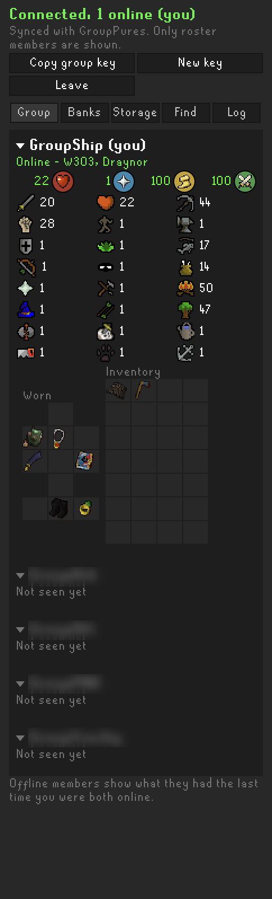
  *Group tab: member card with world/location, vitals orbs, stats, worn gear, and inventory.*

- **Banks:** each member's last bank with value and when it was seen.

  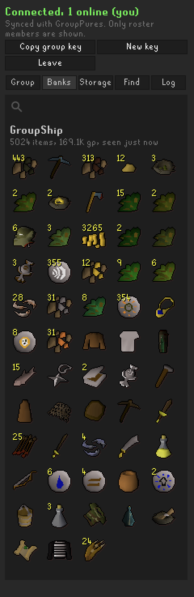
  *Banks tab: member's last seen bank contents and total value.*

- **Storage:** the last group storage contents you saw, plus who took or
  deposited what.

  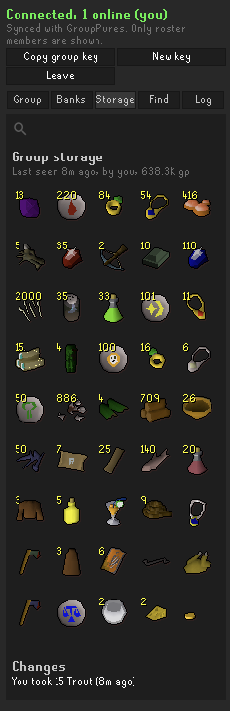
  *Storage tab: snapshot of group storage items and recent change history.*

- **Find:** who has an item and where (bank, inventory, worn, pouches, group
  storage), in the panel or with `::find <item>` in your own chatbox, with
  colours you can change.

  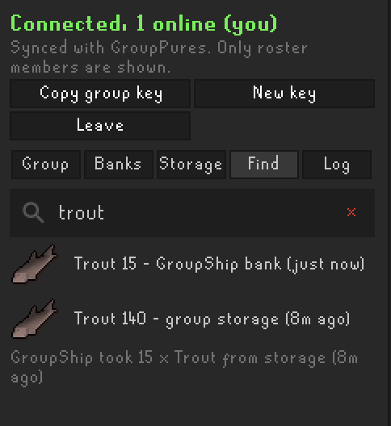
  *Find tab: searching for an item across party members' banks and group storage.*

  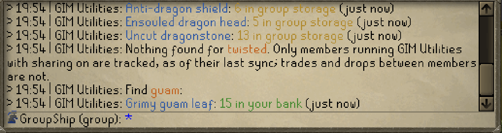
  *Chatbox `::find` command: instant, colour-coded item location lookup.*

- **Log:** every group event, yours and your group's: drops, deaths, levels,
  quests, slayer, diaries, storage visits, online and offline and the rest,
  whether or not they go to Discord or the overlay. "Since you last played"
  on top, then one section per day. Search by member, item, place or text;
  filter by category, member and time (today, 7 days, all). Hover a row for
  the full line and its value; right-click it to copy. The newest 2,000
  events from the last 30 days are kept across restarts.

  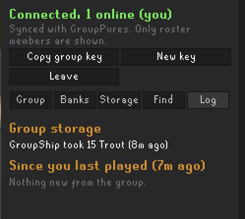
  *Log tab: storage deposits/withdrawals and group activity since your last session.*

- Storage minimums with a desktop notification, and optional world map
  markers.

- **Group events** (new, every one its own switch): valuable drops, pets, new
  collection log slots, untradeable uniques, deaths, big storage deposits and
  withdrawals, storage visit summaries, storage minimums, "took the last one",
  level ups, 99s and max total, XP milestones, combat and total level, quests
  and quest points, online / offline, "back after a break", and Barrows
  chests. Each can go to:
  - **Discord**, through a webhook you set (one per category if you like),
    as rich embeds or plain text, with an optional screenshot, a mention for
    big events, and quiet hours. Each member's client posts only that
    member's own events, so nothing is posted twice.
  - **In-game banners**, yours and your group's, plus an optional group box
    with who is online and the latest events.

  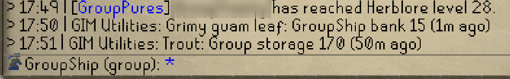
  *Group events: in-game broadcasts for member level ups and achievements.*

- **Settings:** granular opt-in toggles for every feature and sharing
  category, in eight sections: *Group*, *Discord: connection*, *Discord: what
  to post*, *Discord: how to post*, *Discord: daily digest*, *In-game*,
  *Thresholds* and *Advanced* (the last two start closed). See
  [SETUP.md](SETUP.md#settings).

  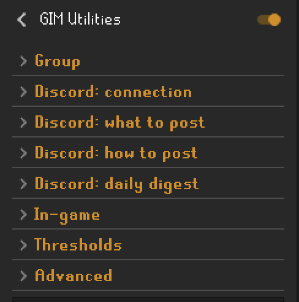
  *Settings: eight sections, every switch off until you turn it on.*

  

Group

  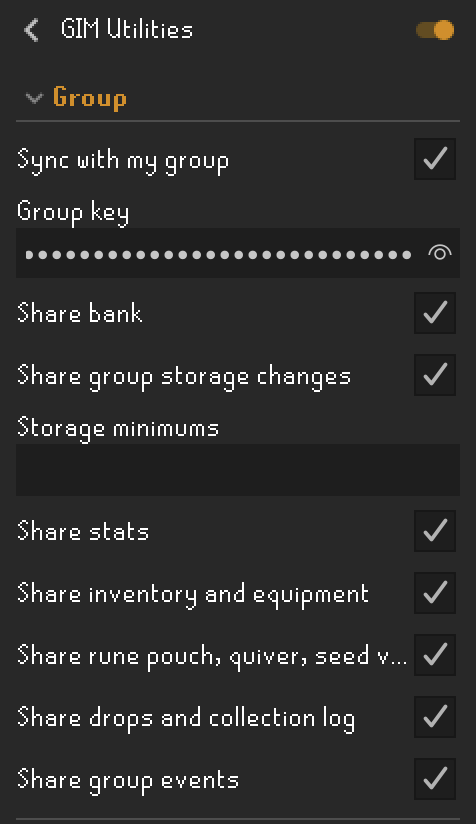

  

  

Discord: what to post

  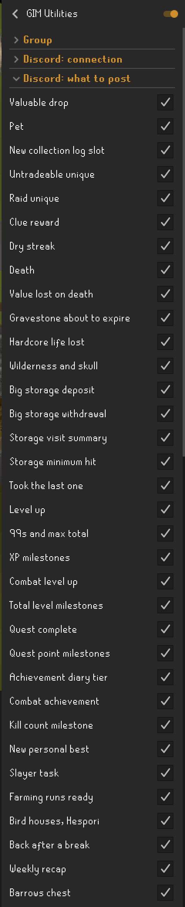

  

  

Discord: how to post

  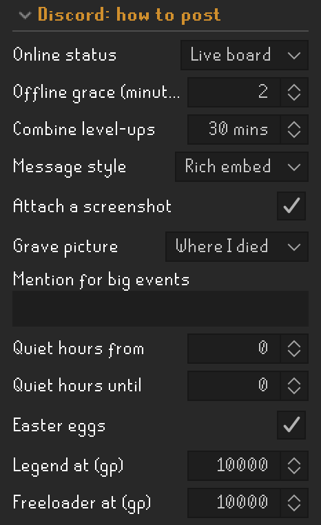

  

  

Discord: daily digest

  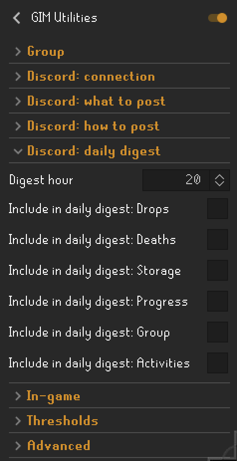

  

  

In-game

  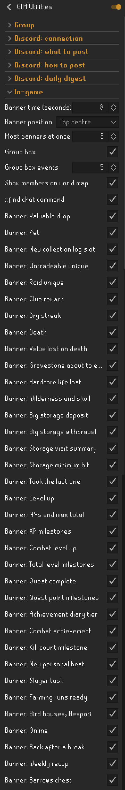

  

No server of its own. Party data goes only through RuneLite's Party service,
and only names on your in-game group roster are shown. **Only the optional
Discord webhook you set** is a network call of the plugin's own: it is off
until you turn on *Post to Discord* and paste a webhook URL, and it sends your
own events and your IP address to Discord.

## Quick start

1. Install *GIM Utilities* from the Plugin Hub and turn on the switches you
   want in its settings.
2. One member opens the GIM Utilities panel, clicks **Create group key**, then
   **Copy group key**, and sends the key to the group (Discord works).
3. Everyone else copies it and clicks **Paste group key**.
4. Each session, click **Join group sync**. The Party plugin is not needed.

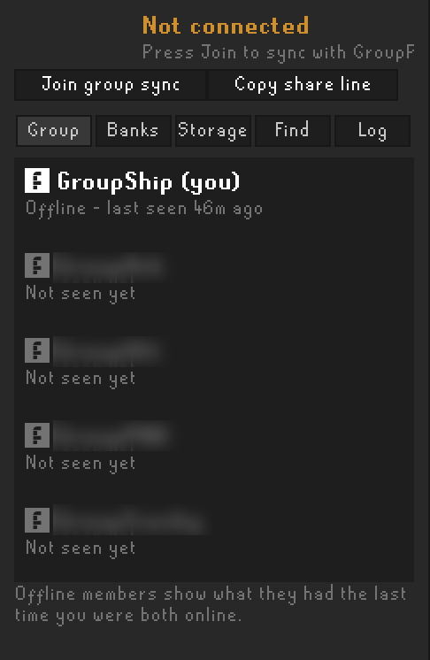
*Group sync: one-click party join without needing the Party plugin.*

Anyone with the key can join your sync, so keep it inside your group.

**Running from source, every setting, and what to test: [SETUP.md](SETUP.md).**

## Coming later

- **Joining on its own.** For now you click *Join group sync* each session:
  RuneLite does not allow plugins to rejoin parties automatically (it would
  load their party servers). We may add auto-join once we have our own
  hosting for group sync; that would be optional, and the Plugin Hub would
  mark the plugin as using a third-party service.
- More group events (raids, clues, diaries, combat tasks and others), and
  banners that only show where they matter.

## License

BSD-2-Clause. See [LICENSE](LICENSE) and
[THIRD_PARTY_NOTICES.md](THIRD_PARTY_NOTICES.md).
