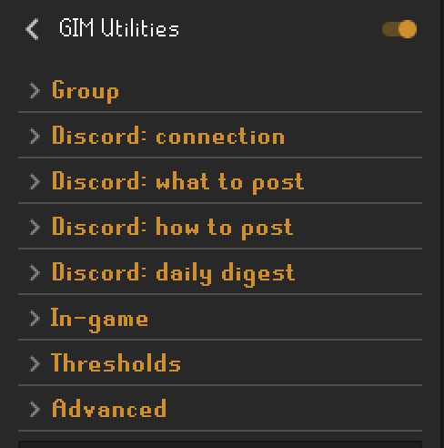
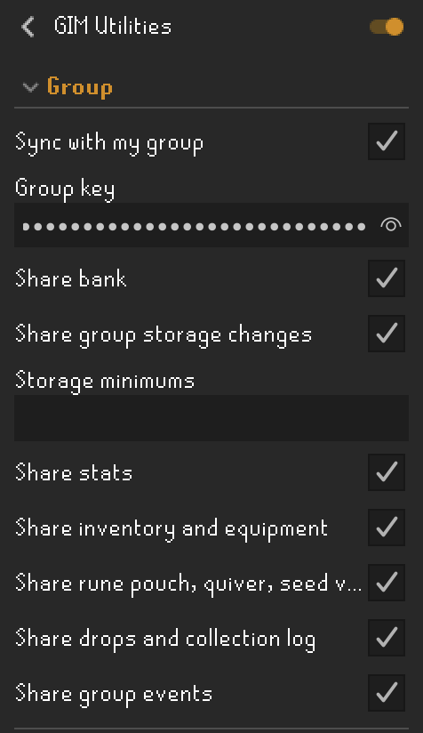
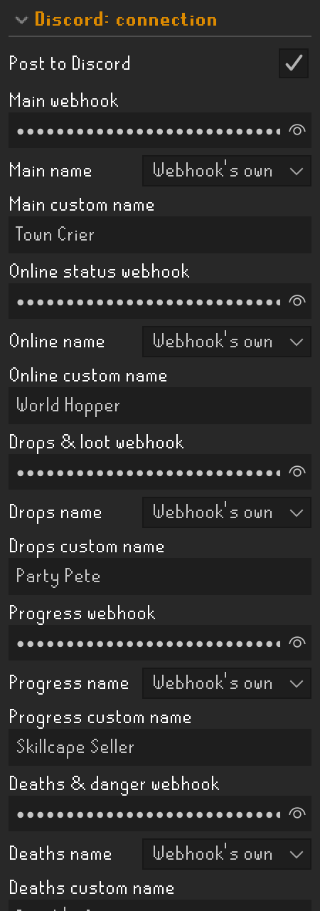
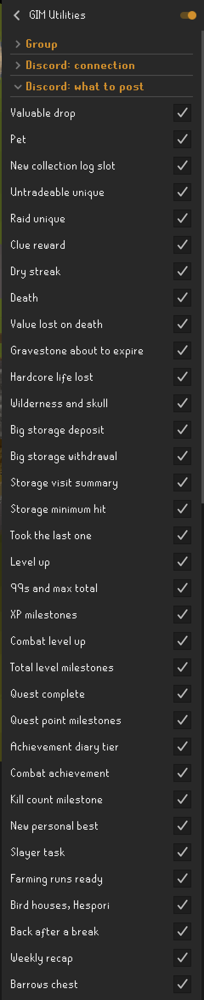
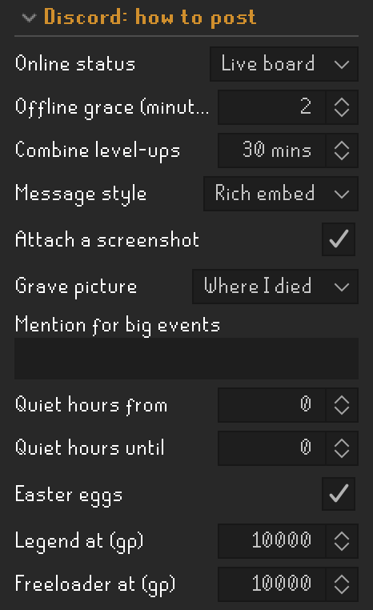
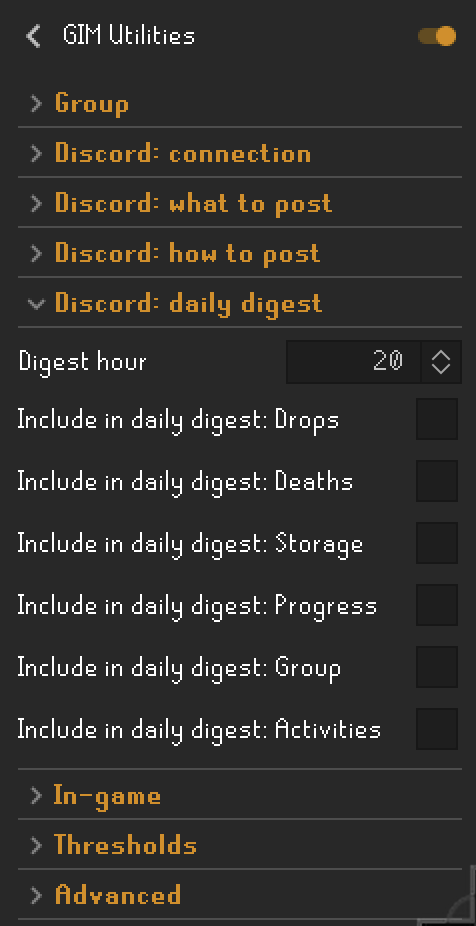
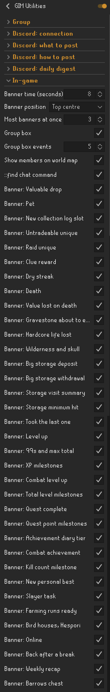
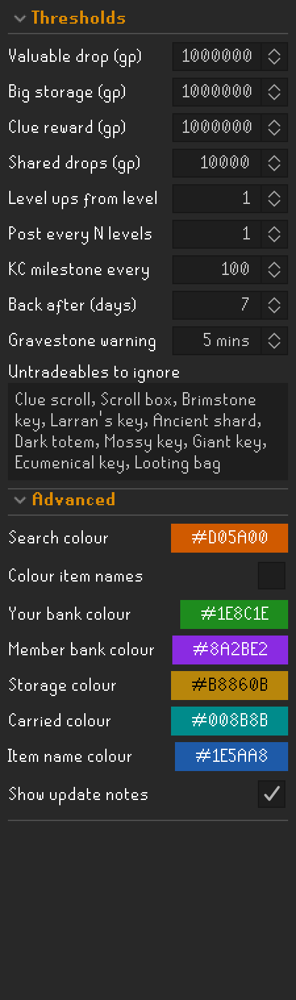

# GIM Utilities: setup, settings and testing

Everything needed to install, configure, build and test GIM Utilities. For an
overview of what the plugin does, see the [README](README.md).

- [Settings](#settings)
  - [Sidebar Quick settings](#sidebar-quick-settings)
  - [1. Group](#1-group)
  - [2. Discord: connection](#2-discord-connection)
  - [3. Discord: what to post](#3-discord-what-to-post)
  - [4. Discord: how to post](#4-discord-how-to-post)
  - [5. Discord: daily digest](#5-discord-daily-digest)
  - [6. In-game](#6-in-game)
  - [7. Thresholds](#7-thresholds)
  - [8. Advanced](#8-advanced)
  - [Item search (`Find` and `::find`) and saved files](#item-search-find-and-find-and-saved-files)
- [Running it next to Build Guard](#running-it-next-to-build-guard)
- [Testing with friends](#testing-with-friends)
  - [Windows: double-click launcher](#windows-double-click-launcher)
  - [What to look at](#what-to-look-at)
- [Limitations](#limitations)
- [Building and tests](#building-and-tests)

## Settings

RuneLite's settings panel for GIM Utilities (`@ConfigGroup("gimutilities")`)
has eight sections in a fixed order. *Group* starts open and the other seven
start closed, so a fresh install shows every section header at a glance.



Every *Share* switch, *Post to Discord*, *Group box*, *Path stop card*, *Show
members on world map*, *::find chat command*, *Shopping: shop alert* and the
daily digest switches default to **Off**. With no *Group key* set, a fresh
install connects to nothing and sends nothing; its sidebar panel opens with an
*Everything is off. Turn on what you want to share.* notice and an **Open GIM
Utilities settings** button. Moving a setting between sections never resets it:
every `keyName` is frozen. GP fields display plain digits (`1000000`) so
seven-figure thresholds fit inside RuneLite's six-column spinner.

When your group leader or an editor saves group-wide settings on the panel's
**Settings** tab, those group values override individual thresholds, event
switches, digest ticks and Discord timing/online-status rules (while webhook
URLs, *Post to Discord*, *Don't post my events* and all *Share* switches always
remain yours alone).

### Sidebar Quick settings

At the top of the GIM Utilities sidebar panel, the foldable **Quick settings**
card exposes the ten most-changed switches directly—each wired two-way to the
underlying RuneLite config key—plus an **All settings** button:

- *Sync with my group* (`groupSync`)
- *Post to Discord* (`discordEnabled`)
- *Keep my events off Discord* (`eventOptOutAll`, same setting as *Don't post my events*)
- *Share bank* (`groupShareBank`)
- *Share storage changes* (`groupShareStorage`, same setting as *Share group storage changes*)
- *Share stats* (`groupShareStats`)
- *Group box* (`overlayGroupBox`)
- *Members on world map* (`groupWorldMap`, same setting as *Show members on world map*)
- *::find chat command* (`groupFindCommand`)
- *Path stop card* (`overlayPathStop`)

### 1. Group

Each *Share* switch works independently, and you only see teammates' data for
categories you also share yourself.

<details><summary>Screenshot: Group</summary>



</details>

| Setting | Default | What it does |
| --- | --- | --- |
| Sync with my group | On | Enables connecting to your group's party via **Join group sync** in the panel header once a *Group key* is set. Does nothing without a key and your click. |
| Group key | *(empty)* | Secret 128-bit party key created or pasted in the panel. Masked password field. Anyone with the key can join the party, so share it only with your group. |
| Share bank | Off | Sends your bank item IDs and counts on bank close, and shows each member's last bank and total value in the **Banks** tab (kept across restarts). |
| Share group storage changes | Off | Sends what you took and deposited when group storage saves, and receives teammates' changes (last 200 saved visits). When off, your own saved visits still show locally marked as not shared. |
| Storage minimums | *(empty)* | Local only (not sent). One `Item: count` per line or comma (e.g. `Shark: 100`). Fires a desktop notification once when a group storage save leaves an item below its minimum, resetting once restocked. |
| Share stats | Off | Sends real and boosted skill levels, HP, Prayer (and whether Prayer is switched on), run energy, special attack, poison / venom / disease state, active follower pet, world and map region (resent every 8 tiles moved and once a minute), and displays teammates'. |
| Share inventory and equipment | Off | Sends your 28 inventory slots, worn gear, jewellery charges, and known log basket / fish barrel / coal bag / looting bag contents for **Group**, **Find**, **Shopping**, **Compare** and **Gear**. |
| Share pouch, quiver, vault | Off | Sends live rune pouch and Dizana's quiver contents plus your seed vault as of the last time you opened it, and displays teammates'. |
| Share drops and collection log | Off | Sends NPC drops worth at least *Shared drops (gp)* and new collection log slots (requires the in-game *Collection log - New addition notification* chat setting), resent for 7 days when members join sync. |
| Share group events | Off | Sends your pets, deaths, level-ups, quests, quest points, diary tiers, boss personal bests, live wave-activity state, logins, announcements and Barrows chests to teammates' panels and banners, and backfills unsynced events into teammates' **Log** and **Activities** when you next join sync. |

### 2. Discord: connection

Each client posts only its own player's events (plus a single elected poster for
in-game Group channel broadcasts when *Members without the plugin* is on), so
nothing is posted twice.

<details><summary>Screenshot: Discord: connection</summary>



</details>

| Setting | Default | What it does |
| --- | --- | --- |
| Post to Discord | Off | Master switch for Discord webhook posts (displays RuneLite's third-party IP address warning). |
| Main webhook | *(empty)* | Discord webhook URL (`https://discord.com/api/webhooks/...`, masked). Receives Main events and any category below whose URL is left empty. |
| Main name | Webhook's own | Poster name mode for Main: *Webhook's own* (name/avatar configured in Discord), *Default name* (`Town Crier`), or *Custom*. |
| Main custom name | `Town Crier` | Poster name used when *Main name* is *Custom* (up to 80 characters; names Discord refuses fall back to the default name with a chat warning). |
| Online status webhook / Online name / Online custom name | *(empty)* / Webhook's own / `World Hopper` | Webhook and poster name for the *Live board* or login/logout posts. Changing this URL starts a fresh board. |
| Drops & loot webhook / Drops name / Drops custom name | *(empty)* / Webhook's own / `Party Pete` | Webhook and poster name for drops, pets, collection log slots, untradeables, raid uniques, Barrows chests and *Took the last one*. |
| Progress webhook / Progress name / Progress custom name | *(empty)* / Webhook's own / `Skillcape Seller` | Webhook and poster name for levels, 99s/max, XP/combat/total/quest-point milestones, quests, and activity start / wave / completion posts. |
| Deaths & danger webhook / Deaths name / Deaths custom name | *(empty)* / Webhook's own / `Death's Office` | Webhook and poster name for deaths, value lost, gravestone warnings, Hardcore lives lost and activity deaths. |
| Group storage webhook / Storage name / Storage custom name | *(empty)* / Webhook's own / `Gielinor Banker` | Webhook and poster name for big deposits/withdrawals, storage visit summaries and storage minimums. |
| Daily digest webhook / Digest name / Digest custom name | *(empty)* / Webhook's own / `Varrock Herald` | Webhook and poster name for daily digests. |
| Don't post my events | Off | Personal opt-out: none of your events are sent to Discord regardless of group settings. Per-event opt-outs live on the panel's **Settings** tab. |

### 3. Discord: what to post

41 per-event switches. Every switch defaults to **Off** except **Activity
started** (**On**, which still sends nothing unless *Post to Discord* and a
webhook are active).

<details><summary>Screenshot: Discord: what to post</summary>



</details>

| Group | Settings in `GroupIronmanConfig` |
| --- | --- |
| Drops & loot | *Valuable drop*, *Pet*, *New collection log slot*, *Untradeable unique*, *Raid unique*, *Clue reward*, *Dry streak*, *Barrows chest* |
| Deaths & danger | *Death*, *Value lost on death*, *Gravestone about to expire*, *Hardcore life lost*, *Wilderness and skull* |
| Group storage | *Big storage deposit*, *Big storage withdrawal*, *Storage visit summary*, *Storage minimum hit*, *Took the last one* |
| Progress & PvM | *Level up*, *99s and max total*, *XP milestones* (1M, 10M, 200M), *Combat level up*, *Total level milestones* (every 100), *Quest complete*, *Quest point milestones* (every 25 and quest cape), *Achievement diary tier*, *Combat achievement*, *Kill count milestone*, *New personal best*, *Slayer task* (completed before new assignment) |
| Timers, activities & group | *Farming runs ready*, *Bird houses, Hespori*, *Back after a break*, *Weekly recap* (Mondays), *Shopping requests*, *Activity started* (**On** by default), *Activity wave milestone*, *Activity completed*, *Activity death*, *Announcement* (`::announce <text>`), *Everyone online* (posted by the group leader's client only) |

### 4. Discord: how to post

At most 20 requests per minute are sent per webhook (up to 50 queued), and
Discord's `Retry-After` rate limits are honoured.

<details><summary>Screenshot: Discord: how to post</summary>



</details>

| Setting | Default | What it does |
| --- | --- | --- |
| Online status | Posts | *Posts* (one message per login/logout), *Live board* (one message edited in place with online members, worlds, activities and offline last-seen times; only one member per webhook should run a standalone board), or *Off*. On leader-shared webhooks, the leader's group *Online status* setting applies automatically. |
| Offline grace | `2 mins` | Minutes (`0-10`) to wait before posting a logout; world hops and quick relogs within the window post nothing. |
| Combine level-ups | `60 mins` | Minutes (`0-240`, `0` off) within which consecutive level-ups by the same member edit one Discord message in place (one card per skill, persisted across restarts). |
| Message style | Rich embed | *Rich embed* (coloured cards with icons) or *Plain text*. |
| Attach a screenshot | Off | Attaches a game screenshot to your Discord posts (level-up shots wait briefly for the chat confirmation banner). |
| Grave picture | Where I died | Screenshot used on *Gravestone about to expire* posts (requires *Attach a screenshot*): *Where I died* (reuses the death-moment frame), *Current view*, or *None*. |
| Mention for big events | *(empty)* | Role or user mention (e.g. `<@&role_id>`) prepended to pets, 99s, max total and Hardcore life-lost posts. |
| Quiet hours from / Quiet hours until | `0` / `0` | Hours (`0-23`) during which Discord posts are held and flushed when quiet hours end. Setting the same hour for both disables quiet hours. |
| Easter eggs | Off | Appends optional RuneScape meme lines to matching posts (levels 67 / 69 / 73 / 92 / 99, max total, combat 126, 2000 total, 200M XP, selected quests, Jad deaths, dry streaks, pets, 0 gp deaths, and storage Legend / Freeloader moves). |
| Legend at (gp) | `1000000` | Minimum group storage deposit value for the Legend Easter egg (`0` disables). |
| Freeloader at (gp) | `1000000` | Minimum group storage withdrawal value for the Freeloader Easter egg (`0` disables). |
| Repost board daily | On | When *Online status* is *Live board*, posts a fresh board at the bottom of the channel after midnight and deletes the previous day's message once saved. |
| Members without the plugin | On | Single elected plugin client relays in-game Group channel broadcasts (`ChatMessageType.CLAN_GIM_MESSAGE`) for roster members not running the plugin, deduplicated across the party. |
| Group posts (minutes) | `30 mins` | Minutes (`0-240`, `0` off) within which same-kind events edit a single per-member Discord message (up to 10 cards; storage visits show net item totals). |
| Add picked-up screenshot | Off | Adds a second screenshot to drop posts once the item appears in your inventory so both ground drop and pickup are shown (posts standalone rather than grouped; requires *Attach a screenshot*). |
| Pickup wait (minutes) | `5 mins` | Minutes (`1-30`) after a drop post during which picking up the item still attaches the second screenshot. |

### 5. Discord: daily digest

Additive daily summaries sent alongside instant posts (never holds instant
posts).

<details><summary>Screenshot: Discord: daily digest</summary>



</details>

| Setting | Default | What it does |
| --- | --- | --- |
| Digest hour | `20` | Local hour (`0-23`) when ticked daily digests and the Monday *Weekly recap* are sent (while logged in). |
| Include in daily digest: Drops | Off | Includes drop events in the daily digest. |
| Include in daily digest: Deaths | Off | Includes death events in the daily digest. |
| Include in daily digest: Storage | Off | Includes group storage events in the daily digest. |
| Include in daily digest: Progress | Off | Includes skill and quest progress events in the daily digest. |
| Include in daily digest: Group | Off | Includes group presence/announcement events in the daily digest. |
| Include in daily digest: Activities | Off | Includes wave-activity and bossing events in the daily digest. |

### 6. In-game

Controls in-game banners, the on-screen Group box, Shopping's path-stop card,
world map markers and `::find`.

<details><summary>Screenshot: In-game</summary>



</details>

| Setting | Default | What it does |
| --- | --- | --- |
| Banner time (seconds) | `8` | Seconds (`2-60`) each event banner stays on screen. |
| Banner position | Top centre | *Top centre*, *Top left*, *Top right*, *Above chatbox*, or *Above player* (Alt-drag to reposition). |
| Most banners at once | `3` | Maximum stacked banners (`1-10`); oldest clears first. |
| Group box | Off | On-screen overlay listing online teammates (with worlds, live activities and active pets) and recent group events (stacking consecutive level-ups). |
| Group box events | `5` | Number of recent events (`1-20`) shown in the Group box. |
| Show members on world map | Off | Marks online teammates on the world map (requires *Share stats* on both sides). |
| ::find chat command | Off | Enables `::find <item>` in the chatbox (local output only). |
| *Banner:* event switches (42 switches) | Off *(except two)* | One *Banner:* toggle per event: *Banner: Valuable drop*, *Banner: Pet*, *Banner: New collection log slot*, *Banner: Untradeable unique*, *Banner: Raid unique*, *Banner: Clue reward*, *Banner: Dry streak*, *Banner: Death*, *Banner: Value lost on death*, *Banner: Gravestone expiring*, *Banner: Hardcore life lost*, *Banner: Wilderness and skull*, *Banner: Big storage deposit*, *Banner: Big storage withdrawal*, *Banner: Storage visit summary*, *Banner: Storage minimum hit*, *Banner: Took the last one*, *Banner: Level up*, *Banner: 99s and max total*, *Banner: XP milestones*, *Banner: Combat level up*, *Banner: Total level milestones*, *Banner: Quest complete*, *Banner: Quest point milestones*, *Banner: Achievement diary tier*, *Banner: Combat achievement*, *Banner: Kill count milestone*, *Banner: New personal best*, *Banner: Slayer task*, *Banner: Farming runs ready*, *Banner: Bird houses, Hespori*, *Banner: Online*, *Banner: Back after a break*, *Banner: Weekly recap*, *Banner: Barrows chest*, *Banner: Shopping requests*, *Banner: Activity started* (**On** by default), *Banner: Activity wave*, *Banner: Activity completed*, *Banner: Activity death*, *Banner: Announcement* (**On** by default), *Banner: Everyone online*. |
| Shopping: shop alert | Off | Prints one chat line per visit when you walk near a reachable shop selling an item a shared Shopping list still needs. |
| Dismiss banners key | Not set | Keybind to clear all active banners (right-clicking a banner and choosing *Dismiss* does the same). |
| Banner quiet from / Banner quiet until | `0` / `0` | Hours (`0-23`) during which banners stay hidden (the **Log** tab still records them). Same hour twice means none. |
| Path stop card | Off | Shows an on-screen card while pathing from the **Shopping** tab with the stop, town, needed items, recipients, prices and next stop. |
| Group box size | Medium | Width, font scale and text detail for the Group box: *Compact*, *Small*, *Medium*, *Wide*, or *Large*. |
| Group box icons | On | Draws skill and item icons on Group box event lines (off shows short text only). |
| Group box times | Short | Relative event timestamps on the Group box: *Short* (`8m`), *Full* (`8m ago`), or *Off*. |
| Empty group box shows | Both | Line shown in the Group box when nobody else is online (rotating every 30s): *Useful* (last-seen times and latest event), *Fun* (time-of-day lines), *Both*, or *Classic* (`Nobody else online`). |

### 7. Thresholds

Shared cutoffs read by both Discord posts and in-game banners.

<details><summary>Screenshot: Thresholds and Advanced</summary>



</details>

| Setting | Default | What it does |
| --- | --- | --- |
| Valuable drop (gp) | `1000000` | Minimum single-stack GP value for *Valuable drop*. |
| Big storage (gp) | `1000000` | Minimum GP value for *Big storage deposit* and *Big storage withdrawal*. |
| Clue reward (gp) | `1000000` | Minimum casket GP value for *Clue reward*. |
| Shared drops (gp) | `10000` | Minimum stack GP value sent by *Share drops and collection log* (`0` shares all NPC drops). |
| Level ups from level | `1` | Ignores skill level-ups below this level (`1-99`). |
| Post every N levels | `1` | Posts every Nth level (e.g. `5` posts 60, 65, 70; 99s and milestones always count). Overridden when group settings exist. |
| KC milestone every | `100` | Boss kills per *Kill count milestone* (`0` disables). |
| Back after (days) | `7` | Full 24-hour periods (`1-365`) away required to trigger *Back after a break*. |
| Gravestone warning | `5 mins` | Minutes remaining (`1-14` of the 15-minute grave timer) when *Gravestone about to expire* / *Banner: Gravestone expiring* fires. |
| Untradeables to ignore | `Clue scroll, Clue geode, Clue bottle, Clue nest, Scroll box, Challenge scroll, Looting bag` | Comma-separated item name prefixes excluded from *Untradeable unique* (keys, totems and shards are announced by default). |
| Every N waves too | `0` | Extra wave interval (`0-100`, `0` none) added on top of built-in activity milestones (Fight Caves `31, 37, 50, 62, 63`; Inferno `30, 50, 60, 66-69`; Colosseum `4, 8, 11, 12`). |
| Activity posts: Fight Caves | On | Enables start, wave, completion and death event posts for the Fight Caves. |
| Activity posts: Inferno | On | Enables start, wave, completion and death event posts for The Inferno. |
| Activity posts: Colosseum | On | Enables start, wave, completion and death event posts for the Fortis Colosseum. |

### 8. Advanced

Customises `::find` chat colours, update notes, and **Compare -> Item** filters.

| Setting | Default | What it does |
| --- | --- | --- |
| Search colour | `#D05A00` | Highlight colour for your query words in `::find`. |
| Colour item names | Off | Applies *Item name colour* to matched item names in `::find`. |
| Your bank colour | `#1E8C1E` | Colour for matches in your own bank. |
| Member bank colour | `#8A2BE2` | Colour for matches in teammates' banks. |
| Storage colour | `#B8860B` | Colour for matches in group storage and storage history lines. |
| Carried colour | `#008B8B` | Colour for matches in inventories, worn gear, rune pouches, quivers, seed vaults and skilling containers. |
| Item name colour | `#1E5AA8` | Item name colour when *Colour item names* is on. |
| Show update notes | On | Prints a one-time welcome line on install and concise update notes in chat once per version. |
| Compare: stats that count | *(empty)* | Comma-separated stats scored by **Compare -> Item** (blank = all: `melee_attack, melee_strength, ranged_attack, ranged_strength, magic_attack, magic_damage, defence, prayer`). |
| Compare: item categories | *(empty)* | Comma-separated slots ranked by **Compare -> Item** (blank = all: `head, cape, neck, ammo, weapon, body, shield, legs, hands, feet, ring, inventory`). |

### Item search (`Find` and `::find`) and saved files

The **Find** tab searches teammates' last synced banks, inventories, worn
equipment, rune pouches, quivers, seed vaults, known log basket / fish barrel /
coal bag contents, and group storage (2+ characters, item shorthands such as
`ppot`, one-click presets, or category / sub-type / holder dropdowns), followed
by the three newest matching storage visits.

With *::find chat command* enabled, typing `::find dragon hunter wand` in your
chatbox prints the same answer locally (up to five lines, with a count of
additional matches):

```
GIM Utilities: Dragon hunter wand: GIM2 bank 1 (2h ago)
GIM Utilities: GIM1 took 1 x Dragon hunter wand from storage (3d ago)
```

It uses `::find` rather than `!find` on purpose: `!` messages are sent to public
or clan chat before RuneLite sees them, whereas RuneLite intercepts `::` via
`CommandExecuted` so your search never leaves your client.

Announcements work the same way: typing `::announce <message>` sends a group
announcement over RuneLite Party without sending public chat.

On-disk cache and state files live under
`.runelite/plugin-data/gim-utilities/` via RuneLite's `Filepath` API
(`group-cache.json`, `status-board.txt`, `level-streaks.txt`,
`grouped-posts.txt`); any legacy `.runelite/gim-utilities/` folder is migrated
automatically by RuneLite on first launch. Deleting `group-cache.json` clears
cached banks, storage history and events on that machine if you switch groups.

## Running it next to Build Guard

GIM Utilities was split out of Build Guard. Both can stay installed together
without touching each other:

- **Settings:** GIM Utilities uses config group `gimutilities`; Build Guard uses
  `build-guard`. Set GIM Utilities up fresh.
- **Party messages:** GIM Utilities sends `VvgGroupIronmanMessage`; Build Guard
  sends `BuildGuardGroupMessage`. Neither plugin decodes the other's traffic, so
  the whole group should use GIM Utilities for group sync.
- **Saved data:** `.runelite/plugin-data/gim-utilities/` here versus
  `.runelite/build-guard/` there.

## Testing with friends

Until GIM Utilities is live on the Plugin Hub, each member runs a **developer
build** launched from this source with your normal `.runelite` profile and
plugins preserved.

1. Install a JDK between 11 and 21, then run `./gradlew run` from the repo
   directory (or use the [Windows double-click launcher](#windows-double-click-launcher)).
2. **Log in** through RuneLite's Jagex Account sidebar button
   ([Using Jagex Accounts](https://github.com/runelite/runelite/wiki/Using-Jagex-Accounts)):
   add your account, choose your character, and click **Play Now**.
3. **Create and share a group key.** Open the GIM Utilities sidebar panel. One
   member clicks **Create group key**, then **Copy group key**, and shares it
   outside the game (Discord, DM). Teammates copy it and click **Paste group
   key**, then click **Turn on sharing** on the **Share with your group?** card
   (**Not now** hides the card until the key changes; **New key** rotates a
   leaked key).
4. **Join each session.** Click **Join group sync** in the panel header once per
   login. The header switches to *Connected, N online*. If you are already in
   another RuneLite party (such as a raid party), GIM sync pauses (*In another
   party; GIM sync paused*) so nothing leaks to outsiders; **Switch to group
   sync** moves you back.

### Windows: double-click launcher

No pre-installed tools or admin rights needed; files stay under
`%LOCALAPPDATA%\GimUtilities`.

1. **Download `Run-GimUtilities.cmd`** from the test release (or
   `tools/windows/` in this repo).
2. **Double-click it:**
   - `[1/3]` locates Java 11-21 or downloads Eclipse Temurin JDK 11 (~200 MB)
     and verifies its pinned SHA-256 hash.
   - `[2/3]` downloads GIM Utilities at tag `gim-test-9` (or uses the enclosing
     repo checkout when run from `tools\windows\`), then downloads and SHA-256
     verifies `combat-vitals.jar` into
     `%USERPROFILE%\.runelite\sideloaded-plugins` (loaded only by `--developer-mode`,
     backing up any differing `combat-vitals.jar` as `.bak`).
   - `[3/3]` builds and launches RuneLite (first run downloads Gradle and
     RuneLite; later runs reuse the cache).
3. **SmartScreen / Smart App Control:** for *"Windows protected your PC"*, click
   **More info -> Run anyway** (or right-click **Properties -> Unblock**). On
   Windows 11 with Smart App Control blocking downloaded scripts, do not disable
   Smart App Control; instead run in **PowerShell**:

   ```powershell
   $f="$env:LOCALAPPDATA\Run-GimUtilities.cmd"; iwr -UseBasicParsing https://raw.githubusercontent.com/VinnyVanGogh/group-ironman-plugin/gim-test-9/tools/windows/Run-GimUtilities.cmd -OutFile $f; cmd /c $f
   ```

   Start subsequent sessions with `cmd /c "$env:LOCALAPPDATA\Run-GimUtilities.cmd"`.
4. Continue from step 2 above (log in, share key, turn on sharing, join).

**macOS, with Combat & Skilling Vitals:** check out `gim-test-9`, place the
release's `combat-vitals.jar` in `~/.runelite/sideloaded-plugins/`, and run
`./gradlew run`.

For maintainers cutting a test release: update `$SourceRef` and `$CvJarSha256`
together in `tools/windows/Run-GimUtilities.cmd`, run
`pwsh -NoProfile -File tools/windows/tests/Checksum.Tests.ps1`, push the public
tag, and re-upload both `Run-GimUtilities.cmd` (CRLF preserved) and the matching
`combat-vitals.jar` to the GitHub release so `.github/workflows/windows-launcher.yml`
(`GU_BUILD_ONLY=1`) passes on both `repo-script` and `release-asset`.

### What to look at

Core tabs and sharing (two or more members in group sync with matching switches on):

1. **Fresh install / sync off.** The GIM Utilities sidebar button is visible,
   opening with *Everything is off. Turn on what you want to share.*, your own
   member card still populates on the **Group** tab, and `::find shark` prints
   nothing while *::find chat command* is off.
2. **Group tab.** Drink a stat-boosting potion, turn on a Prayer, or drop a pet:
   teammates' cards for you show boosted levels (`90 (+8)`), a gold ring on the
   Prayer orb, poison / venom / disease chips when afflicted, and `Pet: <name>`.
   Log out: your status updates immediately from the Group channel to *Offline -
   last seen ...*.
3. **Banks tab.** Open and close your bank: teammates see your collapsible card
   with item count, total value, top-20 preview, *Show all items*, and the nine
   category filter pills. Restart a client: cached banks persist.
4. **Storage tab and minimums.** Open group storage, move items and press
   **Save**: the collapsible *Changes* card logs the visit, category pills
   filter both the grid and the log, and walking away without saving records
   nothing. Set `Shark: 1000` in *Storage minimums* and save below that count:
   one desktop notification until restocked.
5. **Find tab and `::find`.** Use the search bar, *Runes anywhere* / *Food* /
   *Teleports*, or the category/holder dropdowns, then enable *::find chat
   command* and run `::find shark`: local chat lines match the panel and nothing
   appears in public chat.
6. **Log and backfill.** Record a drop or level while disconnected from sync,
   then click **Join group sync**: teammates' **Log** tabs receive the
   backfilled entry at its original time without firing banners or Discord
   posts.
7. **Activities tab.** Enter the Fight Caves, Inferno or Colosseum: **Live now**
   shows your wave, timers, Fight Caves rotation or Colosseum modifiers, and
   collapsible **Wave splits** with personal bests.
8. **Compare tab.** Check **Leaderboard** (skill grid and boss/minigame counts),
   **Compare** (two members side by side), **Group** (hiscore XP against another
   group), **Item** (*Who benefits most?*), and **Banked XP**.
9. **Shopping tab.** Add *1 Defence pure: Mithril gloves* or a *Request: ask the
   group* list: teammates see it, banked/stored items count as *have*, **I'll
   get it** claims a request line, and **Path to** / **Path to next** routes via
   Shortest Path (with *Path stop card* and *Shopping: shop alert* when ticked).
10. **Gear tab.** Walk into Barrows, Vorkath, Zulrah, a raid lobby or Revenant
    Caves (or pick a rule): **Bring this** marks items *OK*, *Equip* or
    *Missing*, naming teammates who hold missing items with **Request from
    group** or **Add to shopping**.

## Limitations

- **Banks are as of the last close; seed vaults as of the last open.** Rune
  pouches and Dizana's quiver update live.
- **Storage history records saved visits by plugin users** with *Share group
  storage changes* on (detected on the Save button or `"Saving..."` modal and
  reconciled on the next open, not an official server log).
- **`Find` and `::find` do not track direct player-to-player trades or ground
  drops** until the recipient's next inventory or bank sync.
- **Location names use bundled region tables** (`regions.txt` and
  `regions-generated.txt`, ~970+ named regions); unmapped regions show
  contextual descriptions (*Wilderness lvl A-B*, *near/under <place>*,
  *Underground*, *Instance* or *Unmapped area*), never raw region numbers.
- **No central server.** Teammates receive live updates and automatic log
  backfills while at least two synced clients overlap online. Drops shared under
  *Share drops and collection log* are `NpcLootReceived` drops (raid purples,
  clue rewards and Barrows chests have their own event switches), and collection
  log detection requires the in-game *Collection log - New addition
  notification* chat setting.
- **Item values and equip requirements:** bank values use RuneLite's cached
  Grand Exchange prices (untradeables count as 0 gp, with High Alchemy shown in
  tooltips). **Compare -> Item** checks bundled OSRS Wiki equip requirements
  (`item-requirements.txt`) for common combat gear and states when an item is
  outside that table.
- **Event caveats:** Barrows set progress counts pieces seen while the plugin is
  on; "every quest done" includes miniquests listed by RuneLite; Hardcore group
  deaths read `GIM_HARDCORE_DEATHS`; poison time left is estimated at 18s per
  remaining hit while venom and disease show state only.

## Building and tests

```sh
./gradlew build         # compiles and runs the headless unit + UI test suite
./gradlew run           # launches a developer client with the plugin side-loaded
./gradlew screenshots   # renders deterministic Swing screenshots into docs/images/
python3 tools/tokens.py # checks main Java token count against Hub review limits
```

Development builds resolve `latest.release` from `repo.runelite.net` and print
the resolved client version before `test` and `run`. To pin a specific client
or build offline:

```sh
./gradlew build -PruneLiteVersion=1.13.6
./gradlew build --offline
```

The Plugin Hub replaces `build.gradle` and `settings.gradle` at submission time
and builds against its own client version.
